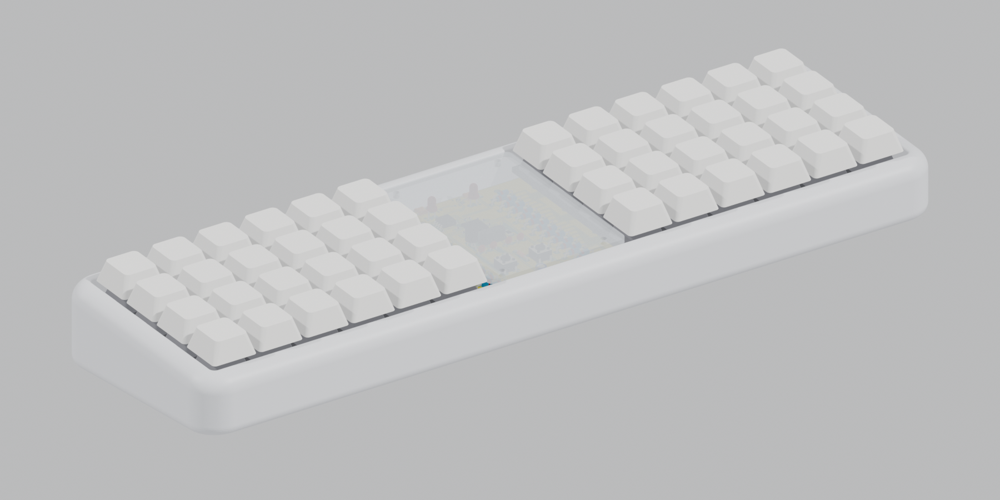
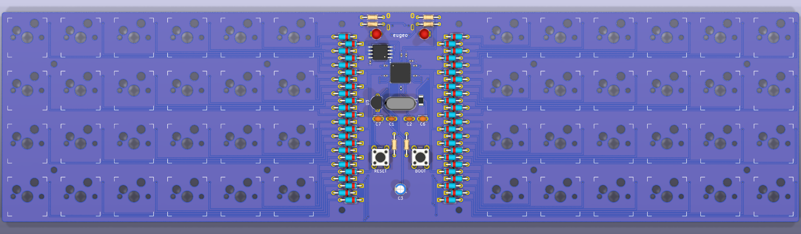
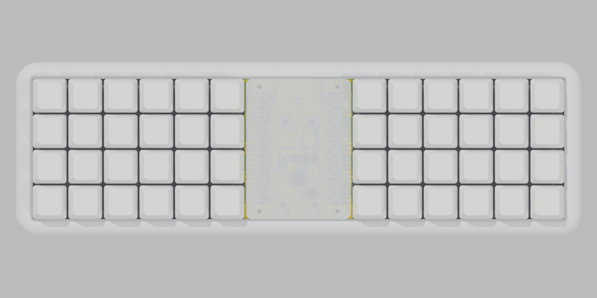
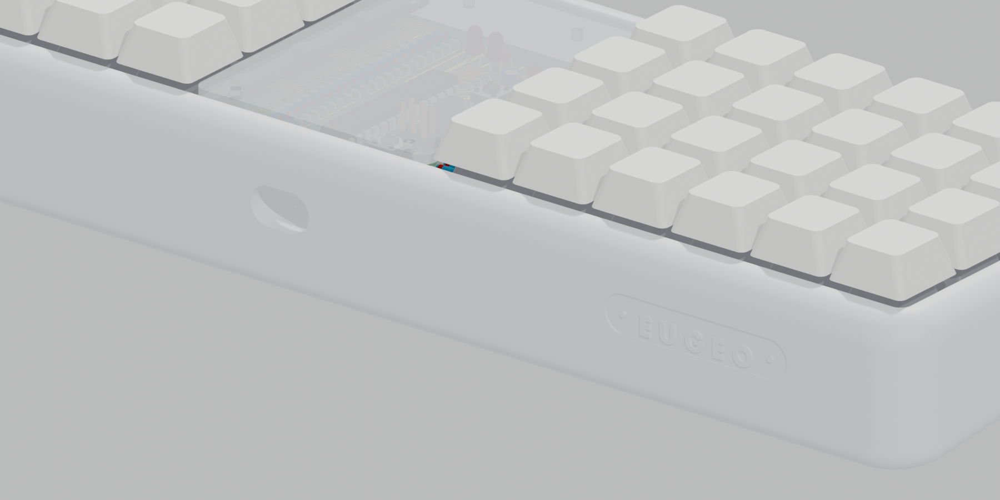
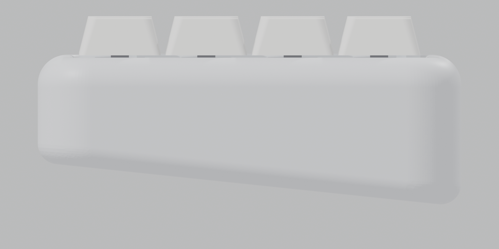
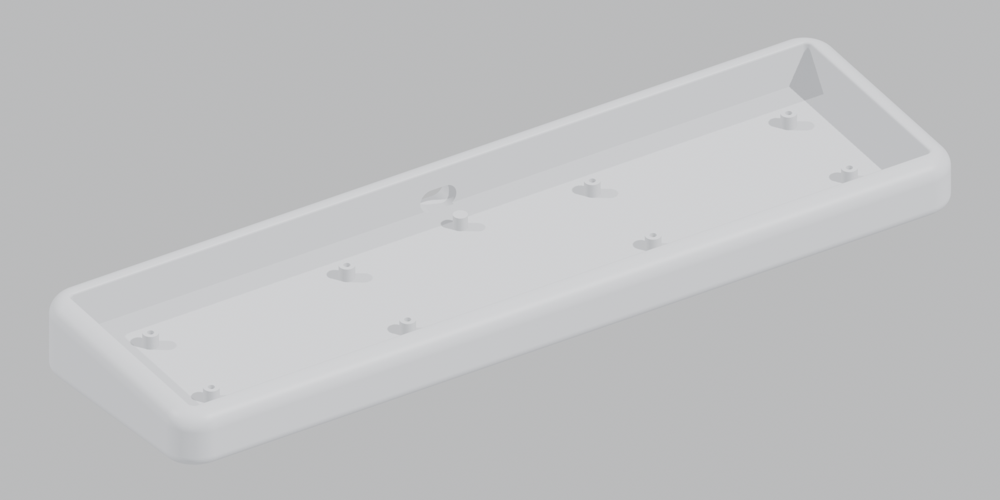
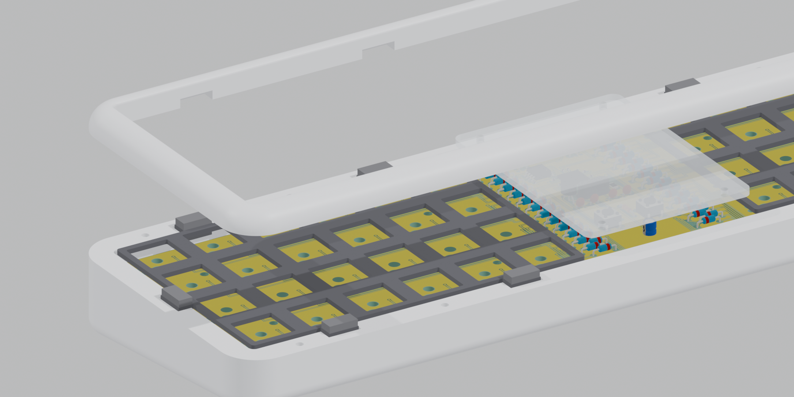
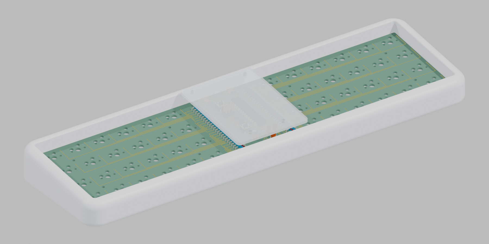

# eugeo

6 キー × 4 行 × 2 ブロック（48 キー）のスルーホール・オーソリニア 40% キーボード PCB です。
[Lumberjack](https://github.com/peej/lumberjack-keyboard)（Paul James 作、MIT License）をベースに、行を 1 段減らし、Kailh の MX 用ホットスワップソケットに対応させました。





| 真上 | 背面 | 側面（6°） |
|---|---|---|
|  |  |  |

組み上がりの画像のスイッチとキーキャップは、大きさと位置の目安として置いた簡易形状です（`scripts/preview_models.py`）。

## Lumberjack からの変更点

| | Lumberjack Rev 1.8 | eugeo Rev 1.0 |
|---|---|---|
| 配列 | 5 × 12（60 キー） | 4 × 12（6 × 4 × 2、48 キー） |
| スイッチ | はんだ付け | Kailh MX ホットスワップソケット（裏面） |
| マトリクス | 6 行 × 10 列 | 8 行 × 6 列（後述） |
| USB-C | 左上・裏面 | 中央上・裏面（ソケットとの干渉回避） |
| 外形 | 60% トレイマウントケース互換 | 284.9 × 75.35 mm。プレートと基板を M2 穴 8 箇所でサンドイッチし、プレートのタブでガスケットマウント |
| ドーターボード用コネクタ (J3-J5) | あり | 削除 |
| 中央カバー | 2 mm アクリル、M2 10 mm スペーサー 4 本 | 同じ構成（ネジはカバーの四隅） |
| マイコン | ATmega328P-PU（DIP）+ V-USB（USB 1.1 Low Speed） | RP2040 + 2 MB QSPI フラッシュ（USB Full Speed、UF2 書き込み） |
| 電源 | USB 5 V 直結 | MCP1700 で 3.3 V（TO-92） |
| 書き込み | ISP ヘッダ（2x3） | BOOT ボタン + USB（UF2）。ISP ヘッダは不要になったので削除 |

マイコンまわりの表面実装部品（RP2040、フラッシュ、0402 のコンデンサなど）は JLCPCB に実装してもらい、それ以外はスルーホール部品のまま残しています。
上部の左右に 1 個ずつの LED、水晶（HC49）、セラミック・電解コンデンサ、LDO（TO-92）、アキシャル抵抗、タクトスイッチ、ダイオード列が中央に並ぶ、Lumberjack の「部品を見せる」見た目を踏襲しています。

## マトリクス

左右のブロックで行を分け、列を共有させた 8 行 × 6 列です。
左右の対称位置の列（左 C0 と右 C11 など）を基板下端の 1 本の配線で共有するので、ROW の配線が MCU をまたがずに済みます。
RP2040 の左辺のピンから左ブロックの行・列 3 本・LED1、右辺のピンから右ブロックの行・列 3 本・LED2 を出し、下辺は水晶と RUN、上辺は QSPI フラッシュと USB に使っています。

| 物理位置 | マトリクス |
|---|---|
| 左ブロック (row r, col c) | ROW r, COL c |
| 右ブロック (row r, col 6+j) | ROW r+4, COL 5-j |

| 設定 | 値 |
|---|---|
| MATRIX_ROW_PINS | GP3, GP4, GP5, GP6, GP26, GP25, GP24, GP23 |
| MATRIX_COL_PINS | GP9, GP10, GP11, GP20, GP19, GP18 |
| DIODE_DIRECTION | COL2ROW |
| LED1 (赤) / LED2 (緑) | GP1 / GP28（上部の左右） |
| BOOT ボタン | QSPI_SS（RP2040 標準の BOOTSEL。1k 経由で GND に落とす） |

## ファイル構成

| パス | 内容 |
|---|---|
| `eugeo.kicad_pro` / `.kicad_sch` / `.kicad_pcb` | KiCad 9 プロジェクト |
| `symbols/`, `footprints/eugeo.pretty/` | プロジェクト専用シンボル・フットプリント（ホットスワップソケット、USB-C、M2 穴） |
| `plates/` | スイッチプレート（ガスケット用タブ付き、左右共通で 2 枚注文）、中央カバー、ボトムプレートの KiCad データと DXF |
| `case/` | Mojo60 風の丸いガスケットマウントケース（下トレイ `eugeo-case-bottom` + 上フレーム `eugeo-case-top`）と中央カバーの STEP / STL |
| `foam/` | プレートフォーム・ケースフォーム・ガスケットパッドの DXF と原寸 PDF |
| `lasercut/yushakobo/` | 遊舎工房レーザー加工サービス用の SVG（中央カバー / スイッチプレート / フォーム） |
| `jlcpcb/` | JLCPCB 実装用 BOM / CPL（表面実装部品とホットスワップソケット） |
| `jlcpcb/full/` | USB-C とスルーホール部品まで JLCPCB に実装してもらう場合の BOM / CPL |
| `gerbers/*.zip` | 製造用ガーバー（PCB、プレート、ボトム） |
| `firmware/qmk/keyboards/eugeo/` | QMK 用キーボード定義とキーマップ（default / via） |
| `firmware/*.uf2` | ビルド済みファームウェア |
| `scripts/` | 回路図・基板・裏面アート（`stump_art.py`）を生成するスクリプト一式 |

## 生成手順

回路図と基板は `scripts/design.py` を唯一の定義として生成しています。
部品配置やネットを変えるときは `design.py` を編集して再生成してください。

```bash
FREEROUTING_JAR=/path/to/freerouting-2.1.0.jar scripts/build_all.sh
```

1. `gen_schematic.py` で回路図を生成し、`check_netlist.py` で `design.py` とネットを照合
2. `build_pcb.py` で部品配置と、キー部分・ダイオード列・USB 端子・RP2040 まわりの配線を引く。RP2040 は電源ピンをパッドの内側の +3V3 リングでまとめ、QSPI・水晶・パスコン・各ピンの引き出しまでを手配線している
3. `route.sh` で残り（引き出した先から各部品まで）を Freerouting 2.1.0 で自動配線
4. `cleanup_dangling.py` で余った配線を削除し、`fill_zones.py` で表裏の GND ベタを流し、`stump_art.py` で裏面のアートを描く
5. DRC（回路図との整合チェック込み）

Freerouting の結果は実行ごとに変わり、まれに未配線が残ります。その場合は `build_all.sh` を再実行してください。
Freerouting 2.1.0 は Java 21 で動きます（2.2 以降は Java 25 が必要）。
初回起動時にできる設定ファイル（macOS では `$TMPDIR/freerouting/freerouting.json`）はテレメトリが有効なので、`allow_telemetry` を `false` にしておくことを勧めます。

製造データは次のコマンドで出力します。

```bash
scripts/export_fab.sh
```

## 製造（JLCPCB）

2026-10-06 に JLCPCB / JLC3DP の見積もりページへアップロードし、次のとおり受け付けられることを確認しました（カート投入・注文はしていません）。

| 部品 | ファイル | JLCPCB の認識 | 見積もり（参考） |
|---|---|---|---|
| PCB | `gerbers/eugeo.zip` | 2 層、284.9 × 75.35 mm | 5 枚 ¥2,269 + 送料 ¥1,536 |
| スイッチプレート | `gerbers/eugeo-plate.zip` | 2 層、113.45 × 75.35 mm。外形レイヤーにスイッチ穴 24 個と M2 穴 4 個（ガスケット用タブを付ける前の版。今の版はタブ込みで 118.45 × 85.35 mm） | 5 枚 ¥630 |
| ケース | `case/eugeo-case.step` | 302.9 × 93.4 × 29.9 mm、198.09 cm³（ふちを上げる前・一体型の版） | 9600 Resin 白 1 個 ¥2,978 + 送料 ¥1,139。MJF ナイロン（PA12）なら グレー ¥11,651、黒染め ¥12,945（2026-10-17） |

PCB の注文設定は既定値（FR-4、1.6 mm、HASL）のままで問題ありません。色は好みで変えてください。
スイッチプレートは銅箔のない基板として注文します。JLCPCB の 2D プレビューでは穴が描かれませんが、Gerber Viewer の Layers 表示で外形に穴が入っていることを確認できます。左右共通なので 2 枚以上あれば足ります。
ボトムプレート（`gerbers/eugeo-bottom.zip`）はケースを使わない場合だけ必要です。

ケースは JLC3DP の 3D Printing で `case/eugeo-case-bottom.step` と `case/eugeo-case-top.step`（または `.stl`）の 2 つをアップロードし、素材に MJF ナイロン（PA12）を選びます。
MJF の最大造形サイズ（380 × 284 × 380 mm）に収まります。
すき間は MJF の寸法公差（±0.3 mm、100 mm を超える部分は ±0.3 %、長さ 303 mm で片側約 0.45 mm）と、内外を塗装したときの塗膜（1 面 0.1〜0.2 mm）を見込んで決めています（ネジ穴 φ2.8、ネジ頭の座ぐり φ5.0、ナット穴 二面幅 4.7 mm）。SLA レジンでも同じデータで作れます。
2026-11-14 は SLA の 9600 Resin 白（Sanding-General Sanding）で注文し、塗装は自分でする（上下で ¥3,265、製作 3 日。MJF PA12 は無塗装で ¥11,905、黒マット塗装付きで ¥13,867）。自分で塗るときは、ネジ穴とナット穴をマスキングしてから黒のサーフェイサー → つや消し黒 → UV カットのつや消しクリアの順に吹く。

### 表面実装部品とソケットの実装を JLCPCB に頼む

RP2040 まわりの表面実装部品（表面）とホットスワップソケット 48 個（裏面）を JLCPCB の PCBA で実装し、残りのスルーホール部品は自分ではんだ付けする想定です。
表裏両面の実装になるので Standard PCBA を選び、Assembly Side は **Both Sides** にして次のファイルをアップロードします。

| ファイル | 内容 |
|---|---|
| `jlcpcb/eugeo-bom.csv` | ソケット（LCSC C41430893）と表面実装部品（RP2040 C2040、W25Q16JVSSIQ C131025、USBLC6-2SC6 C7519、0402 のコンデンサ・抵抗。R7 / R8 / C12 / C13 / U4 は裏面） |
| `jlcpcb/eugeo-cpl.csv` | 実装座標（ガーバーと同じ原点）。ソケットは本体中心・裏面・回転 0、表面実装部品は KiCad の部品位置 |

2026-10-08 に実際にアップロードして確認した結果です（カート投入・注文はしていません）。

- ガーバー: 2 層、284.9 × 75.35 mm として受け付け。Standard PCBA では JLCPCB が上下に 5 mm の捨て基板（エッジレール）を付けるので、届いた基板はレールを折って外す（有料の Depanel オプションで外してもらうこともできる）
- BOM: 7 品目すべてが LCSC 部品に一致（RP2040 C2040、W25Q16JVSSIQ C131025、USBLC6-2SC6 C7519、0402 のコンデンサ・抵抗、ソケット C41430893）
- 部品配置プレビューで、RP2040・フラッシュ・USBLC6 の 1 番ピンとリードがフットプリントに合うことを確認。KiCad の角度のままではフラッシュ（SOIC-8、表）と USBLC6（SOT-23-6、裏）が 90° ずれていたので、`scripts/export_jlc_pcba.py` の `ROT_OFFSET` で補正済み。USBLC6 は 180° 間違えると GND と VBUS が入れ替わるので、部品を変えたときは必ずプレビューで確かめる
- ソケットの回転は 2026-10-06 に確認済み（突起が φ3.05 穴に、端子がパッドに重なる）
- 見積もり: 5 枚で ¥18,706（PCB ¥2,490、PCBA ¥16,215。うち初期費用 ¥8,117、ステンシル ¥2,607、部品 ¥3,406）、送料別

Kailh 純正ソケット（C5184526）にしたい場合は `scripts/export_jlc_pcba.py` の `LCSC` を書き換えてください。

### すべての部品の実装を JLCPCB に頼む

USB-C とスルーホール部品（ダイオード 48 本、抵抗、コンデンサ、水晶、レギュレータ、タクトスイッチ、LED）まで JLCPCB に付けてもらう場合は、`jlcpcb/` の代わりに `jlcpcb/full/` をアップロードします（`python3 scripts/export_jlc_pcba.py --full` で生成）。はんだ付けは不要になり、届いたらスイッチを挿すだけです。

2026-10-08 にアップロードして確認した結果です（カート投入・注文はしていません）。

- BOM: 22 品目すべてが LCSC 部品に一致し、在庫あり
- スルーホール部品の座標は KiCad の原点（1 番ピン）ではなくパッドの中心にしている。USB-C は SMD なので部品位置のまま
- 部品配置プレビューで向きを確認。JLCPCB のモデルでは 3 mm LED のカソードと USB-C の差し込み口が逆向きだったので、`ROT_OFFSET` で 180° 補正済み
- 見積もり: 5 枚で ¥27,679（PCB ¥2,490、PCBA ¥25,188。うち初期費用 ¥8,117、ステンシル ¥2,607、部品 ¥6,949、フィーダー ¥1,954、手はんだ ¥569、手作業実装 ¥1,989、治具 ¥2,607）、送料別。表面実装部品とソケットだけの場合より ¥8,973 高い
- コンデンサ C6 / C7（C1620326）は単価が高く在庫も少なめ（確認時 34 個）、レギュレータ U3（C511277）も在庫 349 個。注文時に在庫切れなら同等品に差し替える

## 裏面のデザイン

基板の裏面は「凍てついた切り株」がテーマです（`scripts/stump_art.py`、`build_all.sh` の中で自動生成）。

- 裏返して左側（表から見て右ブロックの 1 段目と 2 段目の間）に、ケース背面の刻印と同じ Futura の「EUGEO」ロゴを大きく入れている。文字の高さ 7.5 mm、両側に細い線と丸を添える。文字の輪郭は `scripts/logo_outline.py` で `scripts/logo_eugeo.json` に書き出したもの

- 中央に年輪・樹皮・干割れのある切り株をシルクで描き、左右の端に向かって霜の結晶（シダ状の霜）が伸びる
- キーの並ぶ部分にはシルクの雪の結晶を散らす
- 大きめの雪の結晶 7 個はソルダーレジストの開口で、GND ベタの銅がそのまま（HASL なら銀色に）見える。配線・ビア・穴のない GND ベタの上にだけ置く
- シルクはパッド・穴・既存の文字の周りで自動的に切り取り、DRC の警告が出ないようにしている

レジストの色は青（Blue）を勧めます。白いシルクと銀色の結晶が氷のように見えます。

## ケース

Mojo60 を意識した、角と上下のふちを大きく丸めたガスケットマウントのケースです。プレートの中ほどの高さで、下トレイと上フレームの 2 つに分かれています。



| 項目 | 値 |
|---|---|
| 外形 | 302.9 × 93.4 mm、高さ 手前 23.1 mm / 奥 32.9 mm |
| 傾斜 | 6° |
| 角の丸み | 平面 R12、上面のふち R6.5、底面のふち R4.5 |
| ふち | プレート上面から 6.5 mm 上（スイッチの上部が隠れ、キーキャップはその上に出る高さ） |
| 基板と壁のすき間 | 1.0 mm（キーキャップと壁の間は約 1.1 mm） |
| 底面 | 肉抜きして、幅 7 mm のふちで接地 |
| 分割 | プレートの厚さの中央（基板上面から 4.25 mm）で上下に分割。下トレイ 25.2 mm、上フレーム 7.3 mm |
| 刻印 | 奥の壁に「EUGEO」の銘板（後述） |

### 刻印

奥の壁の USB-C の横（背面から見て右）に、銘板風の刻印を入れています。
USB-C の切り欠きと同じ高さ 8.5 mm の長円を 0.6 mm 掘り下げ、Futura の「EUGEO」（文字高さ約 4.4 mm、字間広め）と両端の小さな鋲を元の壁面の高さで残しています。
USB-C の切り欠きと形・高さを揃えて、背面の 2 つの要素が並んで見えるようにしました。


文字・フォント・位置・深さは `scripts/case.py` の `BADGE_*` 定数で変えられます。

寸法は `scripts/case.py` の先頭にある定数で変えられます。再生成の手順は次のとおりです。

```bash
uv venv --python 3.12 .venv && uv pip install --python .venv/bin/python build123d
.venv/bin/python scripts/case.py
kicad-cli pcb export step --subst-models -o /tmp/eugeo-pcb.step eugeo.kicad_pcb
.venv/bin/python scripts/check_case_fit.py /tmp/eugeo-pcb.step   # 基板・部品・プレートとの干渉チェック
```

### ガスケットマウント

左右のスイッチプレートの外周にタブ（幅 10 mm、外へ 5 mm）が 5 本ずつあり、ケースの壁の溝の中で上下から PORON のパッドに挟まれています。
基板はスペーサーでプレートにぶら下がっていて、ケースのどこにも触れません。打鍵の力はパッドで受けるので、たわみと音がやわらかくなります。

| 項目 | 値 |
|---|---|
| タブ | 1 枚のプレートに奥 2 本・手前 2 本・外側 1 本（左右で計 10 本）。左右共通の形で、右側は裏返して使う |
| パッド | 3 mm PORON を 10 × 4 mm に切ったもの 20 個（タブの上下に 1 個ずつ）。溝の中では 2.2 mm に縮む（約 27%） |
| 溝 | タブより左右に 0.5 mm、先端に 1 mm 大きい。高さはプレート 1.5 mm + パッド 2.2 mm × 2 |
| 基板のすき間 | 壁とは 1 mm。ケースの底とは、キー部分が 2.8 mm（3 mm のケースフォームを 0.2 mm つぶして基板の裏に当てる）、中央の部品エリアが 5 mm |
| 上下の固定 | M2×10 なべネジ 8 本を底から通し、上フレームに埋めた M2 ナットで締める |

`scripts/check_case_fit.py` で、基板・部品・プレート・タブがケースに当たらないことと、10 本のタブすべてで上下のパッドの厚みが確保されていることを確かめています。



### 組み立て

インサートを使わずに済むよう、上下のケースは底からネジで留めます。

1. 基板の上面の M2 穴 8 か所（H1〜H8）に M2 3.5 mm のメス-メススペーサーを立て、基板の裏から M2×3 で留める
2. スイッチをプレートにはめ、基板のソケットに差し込み、プレートの上から M2×3 でスペーサーに留める（右のプレートは左と同じものを裏返して使う）
3. 中央カバーを付ける（後述）
4. 上フレームのナット穴（下面）に M2 ナットを 8 個入れる。抜けやすい場合はマスキングテープか少量の接着剤で仮止めする
5. 下トレイの溝の底と、上フレームの溝の天井にガスケットパッドを貼る（PORON は粘着なしなので、両面テープで軽く留める）
6. ケースフォームを下トレイの一段高い床に置き（左右で形が違うので `L` / `R` を確かめ、裏返さない）、基板とプレートの組を載せてタブを溝に合わせる
7. 上フレームをかぶせ、底から M2×10 を 8 本締める。締めすぎるとパッドがつぶれてガスケットの効果がなくなるので、上下が接したところで止める

奥の壁の USB-C 用の切り欠きは 14 × 9.5 mm です（基板がパッドの上で動くぶん、一体型のときより 1 mm 高くしています）。プラグのモールド部分がこれより大きいケーブルは奥まで刺さりません。
底面の四隅に平らな面を残してあるので、直径 8〜10 mm のゴム足を 4 個貼ってください（中心はケースの左右の端から約 10 mm、前後の端から約 10 mm）。

## 中央カバー

Lumberjack と同じく、中央の部品（ダイオード列・MCU・USB 周り）を透明な板で覆えます。



| 項目 | 値 |
|---|---|
| 大きさ | 56.2 × 75.35 mm、角 R3、厚さ 2 mm |
| 取り付け | カバーの四隅に合わせた基板の M2 穴 4 か所（H9〜H12）に M2 10 mm のメス-メススペーサーを立て、下から M2×4 で基板に、上から M2×4 でカバーを留める |
| 高さ | カバーの下面は基板上面から 10 mm。下でいちばん高い LED1（8.29 mm）との間に 1.71 mm のすき間 |
| ケースとの関係 | カバーの上面はケースのふちより約 0.5 mm 上。ケース・キーキャップとは重ならない |

| ファイル | 用途 |
|---|---|
| `plates/eugeo-cover.dxf` | アクリル板のレーザーカット用（推奨） |
| `case/eugeo-cover.step` / `.stl` | 3D プリントや CNC 用 |
| `gerbers/eugeo-cover.zip` | JLCPCB で FR4 板として作る場合（不透明になる） |

JLCPCB の基板サービスでは透明な板は作れないため、透明にしたい場合はアクリルのレーザーカットサービスに DXF を出してください。
JLC3DP の SLA で作る場合は、見積もり画面で透明系のレジンが選べるか確認してください。

## フォーム

打鍵音とたわみの調整用の 2 種類のフォームと、ガスケットマウント用のパッドの型を用意しました。プレートフォームは左右同じ形なので 1 つの型で 2 枚切り、片方は裏返して使います。ケースフォームはソケットの向きが左右で同じため、左用と右用で形が違います（裏返さずにそのまま置く）。

| ファイル | 位置 | 推奨素材 | 形 |
|---|---|---|---|
| `foam/eugeo-plate-foam` | プレートと PCB の間（3.5 mm） | 3 mm PORON | プレートと同じ外形、スイッチ下部を逃がす 14.5 mm 角穴、スペーサー用 φ4.4 穴 |
| `foam/eugeo-case-foam-left` / `-right` | PCB とケース底の間（キー部分 2.8 mm） | 3 mm PORON | キー部分のみ（中央の部品エリアは空ける）。ホットスワップソケット・はんだ付けの足・スイッチの中心軸と足を 0.5 mm 大きく逃がす穴と、基板の裏のネジ頭を逃がす φ7 穴。外形との間が 2 mm 未満になるところは切り欠きにしている |
| `foam/eugeo-gasket-pad` | プレートのタブの上下（ケースの溝） | 3 mm PORON | 10 × 4 mm、20 個 |

`.dxf` はレーザーカット業者向け、`-1to1.pdf` は手で切るための原寸の型紙です。PDF は A4 横で、倍率 100% で印刷し、100 mm のスケールバーで寸法を確かめてから使ってください。
ケースのキー部分の床は基板の裏から 2.8 mm の高さに上げてあり、3 mm のケースフォームがソケットを避けながら基板の裏に軽く当たります。ソケットやスイッチの足にフォームが当たらないことは `scripts/check_case_fit.py` で確かめています。
JLCPCB ではフォームのカットは扱っていないため、遊舎工房のレーザー加工（下記）に出すか手で切ってください。
スイッチプレートは、ケースの内側に 1 mm のすき間で収まり、ケースのふちより 6.5 mm 低い位置に来ることを確認済みです。

## 遊舎工房のレーザー加工

[遊舎工房のレーザー加工サービス](https://yushakobo.jp/lasercut/)に、そのまま入稿できる SVG を `lasercut/yushakobo/` に用意しました。
遊舎工房配布の Inkscape テンプレートを土台にし、注文サイズの作業領域だけを残しています。

| ファイル | 注文するサービス / 素材 / 厚さ / サイズ | 中身 |
|---|---|---|
| `eugeo-cover_acrylic-clear-2mm_450x300.svg` | [レーザー加工サービス](https://shop.yushakobo.jp/products/lasercut)（アクリル）/ アクリル クリア / 2mm / 450x300 | 中央カバー 26 枚（縦向き 7 枚 × 3 段 + 横向き 5 枚） |
| `eugeo-switch-plate_pom-1.5mm_490x245.svg` | [レーザー加工サービス（その2）](https://shop.yushakobo.jp/products/lasercut-2) / POM / 1.5mm / 490x245 | ガスケット用タブ付きスイッチプレート 8 枚（4 台分。左右共通、右は裏返して使う）。隣り合うプレートのタブを互い違いにかみ合わせ、4 mm 空けて並べている |
| `eugeo-foam_poron-3mm_500x300.svg` | レーザー加工サービス（その2）/ フォーム / 3mm / 500x300 | キーボード 3 台分。プレートフォーム 6 枚 + ケースフォーム左右 3 組 + ガスケットパッド 60 個（1 段目〜3 段目が 1 台分ずつ） |

- 穴などの内側はカット①（赤）、外形はカット②（青）です。内側を先に切ってから部品を切り離す順番になります
- 線幅 0.001 mm、塗りなし、RGB、ファイル名は半角英数字です。シート端から 3.5 mm 以上、部品同士は 3 mm 以上空けています（規定は 3 mm / 2 mm 以上。部品同士はタブ込みの外形どうしの距離で `check_lasercut_svg.py` が確かめる）
- レーザーは線の上を切るため、穴は線より少し大きく、外形は少し小さく仕上がります。POM プレートのスイッチ穴（14.0 mm）が緩い場合は、注文時に相談してください
- スイッチプレートは JLCPCB の FR4（`gerbers/eugeo-plate.zip`、1.6 mm）と POM のどちらで作っても同じ形です。ガスケットマウントでは、たわむ POM のほうが向いています

テンプレートはリポジトリに含めていません。作り直すときは、遊舎工房の [Laser_Cut_template](https://drive.google.com/drive/folders/1BYeC-_gsrWUxI49BNqbQBk6OOC30LgTS) の Inkscape フォルダにある `Laser_acrylic_template.svg`、`Laser_POM_template.svg`、`Laser_Poron_template.svg` を 1 つのフォルダに置き（POM / Poron はファイル名を小文字の `pom` / `poron` にする）、次を実行します。

```bash
python3 scripts/export_yushakobo_svg.py <テンプレートのフォルダ>
python3 scripts/check_lasercut_svg.py
```

## 組み立て（基板）

- ホットスワップソケットと USB-C は裏面、それ以外の部品は表面に付けます
- ダイオードは帯（カソード）を MCU 側に向けます。左列はシルクの右側、右列は左側がカソードです
- プレートと PCB の間は 3.5 mm（1.5 mm 厚プレートでスイッチ底面が PCB に接する高さ）です
- ケースを使わずボトムプレートで挟む場合は、裏面の USB-C とソケットを避けるため PCB とボトムの間を 8 mm 程度空けます

## ファームウェア

`firmware/qmk/keyboards/eugeo` を qmk_firmware の `keyboards/` にコピーしてビルドします。
2026-10-07 時点の qmk_firmware でビルドできることを確認済みです。ビルド済みの `firmware/eugeo_default.uf2` / `firmware/eugeo_via.uf2` も置いてあります。

```bash
qmk compile -kb eugeo -km via
```

RP2040 は ROM にブートローダーを持っているので、ブートローダーの書き込みは要りません。

1. BOOT を押したまま RESET を押して離す（何も書き込まれていない新品の RP2040 は USB をつなぐだけでよい）
2. `RPI-RP2` という USB ドライブとして認識される
3. `eugeo_via.uf2` をそのドライブにコピーすると、書き込み後に自動で再起動する

`qmk flash -kb eugeo -km via` でも同じことができます。キーマップに `QK_BOOT` を割り当てておけば、BOOT ボタンを使わずに書き込みモードに入れます。

### Remap / VIA

`via` キーマップは VIA 対応（`VIA_ENABLE = yes`）で、[Remap](https://remap-keys.app) と VIA のどちらからでもキー配置を変えられます。

1. Chrome か Edge で Remap を開き、「Configure」から eugeo を接続する
2. Remap のカタログに未登録のうちは定義ファイルを求められるので、`firmware/via/eugeo.json` を読み込む

`firmware/via/eugeo.json` は VIA v3 形式の定義ファイルで、物理配列どおり左右ブロックの間を 3U 空けています。VIA の Design タブでもそのまま読み込めます。
Remap のカタログに登録すると、Remap の画面からファームウェアの書き込み（UF2 のダウンロードとコピーの案内）もできるようになります。

Remap のカタログに登録すれば、定義ファイルを読み込まなくても自動で認識されます。登録は Remap に GitHub アカウントでログインして申請し、ファームウェアのソースの場所（GitHub のリポジトリなど）を示します。
VID / PID（`0x6B6E` / `0x4547`）は自分で決めた値です。登録前に、他のキーボードと重複していないか Remap 上で確認してください。

## 動作の検証

実機は作っていないため、基板データからの検証で、はんだ付けすれば動くことを確認しています。

- KiCad の DRC: 違反 0、未接続 0、回路図との整合 OK。ERC も 0 件
- `scripts/verify_design.py`（59 項目すべて合格）
  - RP2040 のシンボルのピン名がデータシート（QFN-56）と一致すること
  - 電源: IOVDD 6 本・ADC_AVDD・VREG_VIN・USB_VDD が +3V3、VREG_VOUT が DVDD 2 本に、パスコンの数と RP2040 からの距離、MCP1700 のピン配置
  - 12 MHz 水晶と 1k 直列抵抗、22 pF、RUN のプルアップと RESET、BOOT（QSPI_SS を 1k で GND へ）
  - QSPI フラッシュの 8 ピンが RP2040 の QSPI 信号と一致すること
  - USB: D+ / D- が 27Ω 経由で USB_DP / USB_DM に、USBLC6、CC の 5.1k、VBUS のポリスイッチ
  - LED とコンデンサの極性、ダイオードの向き（COL2ROW）、QMK の LED ピン設定
  - 48 キーすべてについて、基板上の行・列の GPIO が QMK の `keyboard.json` と一致すること
- RP2040 まわりは、電源ピンをパッドの内側の +3V3 リングでまとめ、+1V1 は裏面経由で 3 ピンをつなぎ、QSPI・水晶・パスコン・行と列の引き出しまでを手配線しています。0.4 mm ピッチの間をすり抜ける配線はありません
- 中央カバー: カバー下面と部品の最小すき間 1.71 mm（LED1）、カバーとケース・部品の干渉 0（`scripts/check_case_fit.py`）
- ソケットのフットプリント: パッド位置・サイズが [keyswitch-kicad-library](https://github.com/perigoso/keyswitch-kicad-library) の SW_Hotswap_Kailh_MX_1.00u と一致。ソケットの突起が入る穴は同ライブラリに合わせて φ3.05 mm

```bash
KP=/Applications/KiCad/KiCad.app/Contents/Frameworks/Python.framework/Versions/Current/bin/python3
$KP scripts/verify_design.py
```

### 発注前チェック

発注の前に `scripts/preorder_check.py` を実行してください（2026-10-07 時点で 23 項目すべて合格）。DRC で見えない次の点を確かめます。

- 前の版との差分が、意図した部品の追加・削除だけであること（ほかのパッドの位置と接続が変わっていない）
- 全部品が `design.py` どおりの位置・向き・面にあり、外形も設計どおりであること
- スペーサー・ネジ頭が当たる範囲に、むき出しの銅箔がないこと。ビアがすべてレジストで覆われていること（マスクのガーバーでも確認）
- 実際の基板の最小値（線幅 0.15、ビア φ0.3 / 0.6、穴、スロット、シルク文字 1.0 mm）が JLCPCB の製造基準を満たすこと
- `gerbers/eugeo.zip` が今の基板から出したものと一致し、ドリルデータに M2 穴 12 個が設計位置どおりにあること
- JLCPCB の実装座標（ソケットと表面実装部品）と LCSC 番号、スイッチプレート・中央カバー・ボトムプレートの穴が基板の穴と一致すること
- 遊舎工房向け SVG が入稿ルールを満たすこと、59 項目の機能チェックが通ること

```bash
$KP scripts/preorder_check.py --base <前回発注した版の git リビジョン>
```

## 未検証の点

- 試作していません。上記の検証、ケースとの干渉チェックは通っています
- JLCPCB の部品の回転角はプレビューで確認しただけです。部品を変えたら注文時の配置プレビューで 1 番ピンの向きを確かめてください（上の「表面実装部品とソケットの実装を JLCPCB に頼む」）
- USB-C コネクタ（TYPE-C-31-M-12）は 0.5 mm ピッチの SMD で、手はんだでは一番難しい部品です（Lumberjack と同じ部品）
- ケースの USB-C 部はコネクタの 3D モデルがないため、寸法計算だけで確認しています
- ホットスワップソケットのフットプリントは keyswitch-kicad-library と同寸で、JLCPCB の部品配置とも一致しましたが、実物のソケットでの勘合は未確認です

## License

ハードウェア（回路図・基板・プレート・ケース・フォーム）とスクリプトは MIT License です。Lumberjack の著作権表示を `LICENSE` に残しています。
`firmware/qmk/` 以下のファームウェアは QMK に合わせて GPL-2.0-or-later です。
